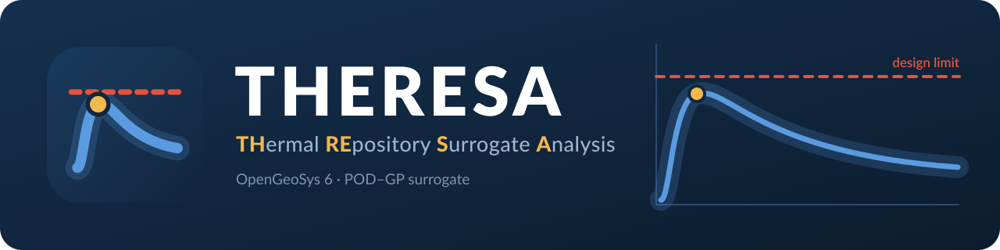
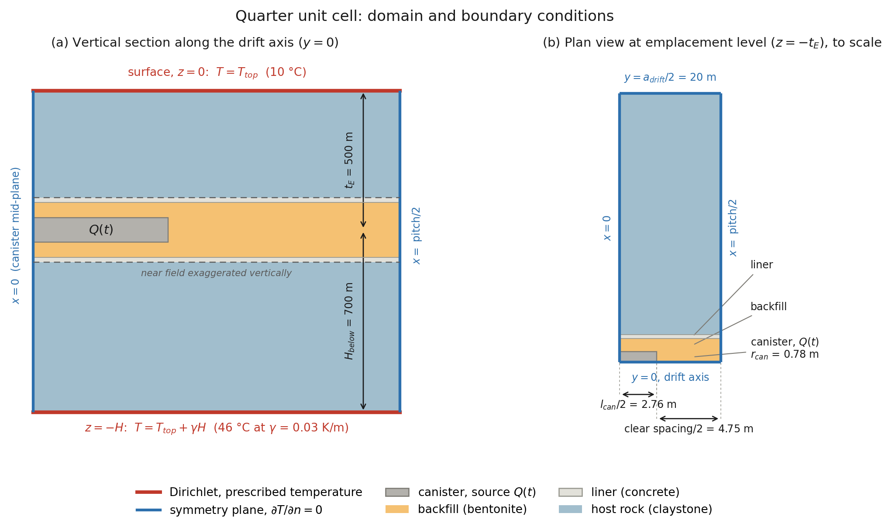
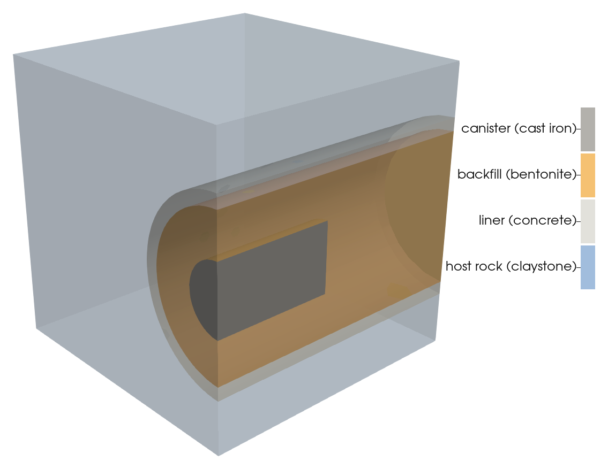
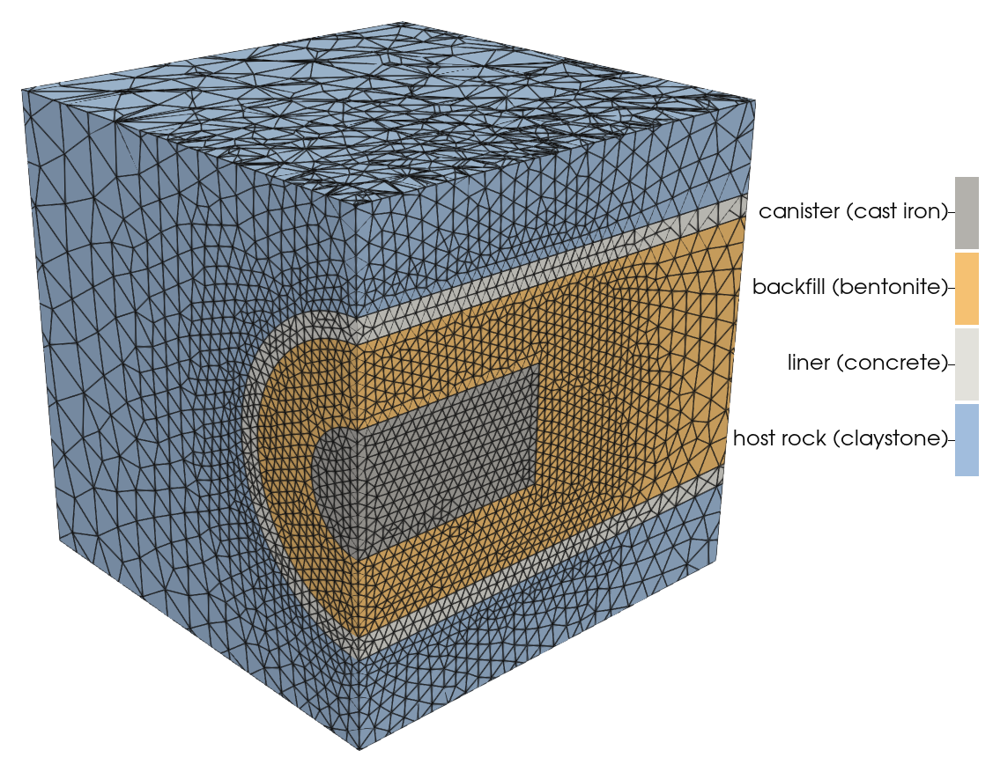
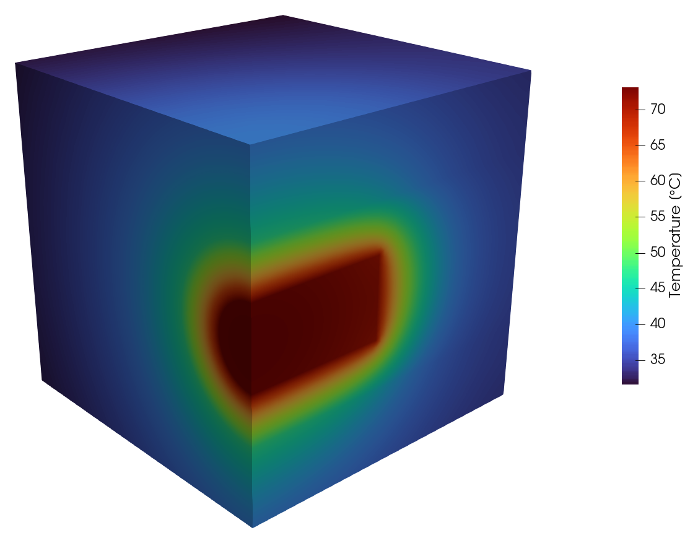

<p align="center">
  
</p>

# THERESA

**THErmal REpository Surrogate Analysis** — peak temperature at the surface of
a waste canister in drift emplacement over 1000 years, from a 3D
[OpenGeoSys 6](https://www.opengeosys.org/) heat-conduction model and a
surrogate model of it that evaluates in milliseconds.

[](https://theresa.streamlit.app/)
[](https://github.com/frederik-f/theresa/actions/workflows/tests.yml)

<p align="center">
  <picture>
    <source media="(prefers-color-scheme: dark)" srcset="docs/figures/temperature-dark.svg">
    
  </picture>
</p>

- **Direct simulation** of a design point: Gmsh mesh of the quarter unit cell,
  OGS `HEAT_CONDUCTION`, about 2 minutes.
- **Surrogate prediction** of the full temperature history with interpolation
  uncertainty, about 60 ms.
- **Admissible loading**: largest canister power that meets a temperature
  limit, in closed form.
- **Sensitivity analysis**: first-order and total Sobol indices of the peak
  temperature.
- **GUI** (Streamlit, German/English, light and dark theme) with direct OGS
  comparison.

> [!IMPORTANT]
> **Disclaimer.** THERESA is a private hobby project for trying out simulation
> and surrogate-modelling techniques. Geometry, material parameters, decay-heat
> spectra and the design limit are simplified or assumed values, loosely based
> on published literature; they are not realistic and do not describe any
> existing or planned repository. The results are not suitable for design,
> licensing or safety assessments. The software comes without warranty
> (GPL-3.0, sections 15 and 16).

## Model

Quarter of the unit cell around one canister (Pollux type, 5.52 m long,
1.56 m diameter), bounded by four vertical symmetry planes: an infinite array
of simultaneously emplaced canisters.

<p align="center">
  
</p>

Pure heat conduction with constant properties in four materials (canister,
backfill, liner, host rock); Dirichlet conditions at top and bottom, zero flux
on the symmetry planes; uniform volumetric source in the canister.

<table>
  <tr>
    <td></td>
    <td></td>
    <td></td>
  </tr>
  <tr>
    <td align="center">Material regions</td>
    <td align="center">Tetrahedral mesh</td>
    <td align="center">Temperature at 6.3 a</td>
  </tr>
</table>

Near field (6.5 m cube at the drift axis) of the reference design: clear
canister spacing 9.5 m, drift spacing 40 m, depth 500 m, 1235 W at emplacement.

## Method

The problem is linear. Inputs are therefore treated as follows:

| input | treatment |
| --- | --- |
| surface temperature, geothermal gradient | analytic: `T_ss = T_top + g · ψ(x)` |
| emplacement depth | analytic: shift of `ψ` (validated 300–1000 m) |
| decay-heat curve (amplitudes, half-lives, any number of terms) | analytic: closed-form Duhamel convolution |
| canister loading, interim storage | analytic: scaling of the source amplitudes |
| design limit | evaluation threshold |
| clear canister spacing, drift spacing | **interpolated** |
| conductivity and volumetric heat capacity of all four materials | **interpolated** |
| canister length | fixed per trained surrogate |

- **Steady state.** `ψ` solves the source-free problem with boundary values
  0 and `H`; one solve per design covers all surface temperatures and
  gradients.
- **Step response.** One OGS run per design with a constant 1 W source gives
  the step response `S(x, t)` in K/W. With `S` piecewise linear in time and an
  exponential-sum source, the convolution is exact.
- **Surrogate.** Step responses and `ψ` of 400 Latin-hypercube designs are
  reduced by SVD to a mean and 8 modes (POD); each mode coefficient is
  interpolated by a Gaussian process (Matérn 5/2, ARD) in reciprocal
  coordinates for spacings and conductivities. The GP variance is propagated
  linearly to a temperature uncertainty.
- **Admissible loading.** `min over (t, x) of (limit − T_ss) / ΔT` times the
  current power.

Derivations: [`docs/theory.pdf`](docs/theory.pdf).

## Accuracy

| quantity | value |
| --- | --- |
| Duhamel construction vs. direct simulation, peak | +0.07 K |
| surrogate vs. 20 hold-out simulations, worst / mean absolute | 0.130 K / 0.038 K |
| spatial discretisation error of the peak (Richardson) | −0.28 K |
| temporal discretisation error of the peak | < 0.005 K |

Details: [`docs/measurements.md`](docs/measurements.md).

Trained ranges: clear canister spacing 2.5–15 m, drift spacing 15–60 m,
material properties over their literature ranges (`DEFAULT_RANGES` in
[`theresa/doe.py`](theresa/doe.py)). Predictions outside these ranges, with an
interpolation uncertainty above 0.5 K, or with the maximum at the end of the
record carry a warning.

## Installation

Requires Python 3.13. OpenGeoSys and Gmsh are installed as binary wheels
(`ogs`, `gmsh`).

With [uv](https://docs.astral.sh/uv/):

```bash
uv sync --extra gui
```

Optional extras: `gui` (Streamlit), `test` (pytest), `docs` (Sphinx), `dev`
(ruff, pre-commit); `--all-extras` installs all of them.

With pip:

```bash
python3.13 -m venv .venv
```

```bash
.venv/bin/pip install -e ".[gui]"
```

`uv.lock` pins the dependency tree.

**Tested with:** Python 3.13.15, OpenGeoSys 6.5.9, Gmsh 4.15.2, ogstools
0.8.2, NumPy 2.5.3, SciPy 1.18.1, scikit-learn 1.9.1, matplotlib 3.10.9,
Streamlit 1.64.0; the test suite also passes with the minimum versions in
`pyproject.toml`. The included surrogate requires scikit-learn 1.9; other
versions require `theresa train`.

## Usage

The trained surrogate is included (`data/surrogate.pkl`).

### Command line

```bash
uv run theresa predict --canister-spacing 9.5 --a-drift 40 --depth 700 --plot T.png
```

```
peak temperature       79.0 degC   (within limit, limit 100 degC)  +/- 0.06 K interpolation
time of peak            6.3 a
undisturbed rock       31.0 degC
heating at peak        48.0 K
at 1000 a              52.1 degC
canister loading       1235 W at emplacement
max admissible         1777 W (1.44 x the loading above) for the 100 degC limit
```

| command | function |
| --- | --- |
| `theresa predict` | surrogate prediction; `--plot`, `--csv` |
| `theresa simulate` | direct OGS simulation of one design |
| `theresa sobol` | Sobol indices; `--scope materials` or `all` |
| `theresa validate` | surrogate against direct simulations of hold-out designs |
| `theresa train` | generate training data and fit the surrogate (400 runs) |

`theresa <command> --help` lists all options.

### GUI

```bash
uv run theresa-gui
```

Sliders for all parameters with immediate update; the loading is set as a
number of fuel elements, as a thermal power, or fitted to the design limit.
**Check with OGS** runs the direct simulation for the current inputs and
overlays it on the prediction; the run can be stopped at any stage.

#### Online deployment

The GUI runs at [theresa.streamlit.app](https://theresa.streamlit.app/) on
[Streamlit Community Cloud](https://share.streamlit.io), deployed from the
public GitHub repository:

1. Sign in with the GitHub account and create an app from the repository.
2. Entry point `theresa_gui/app.py`; Python 3.13 under *Advanced settings*.
3. Deploy. Each push to `main` updates the app.

`theresa_gui/requirements.txt` installs the prediction stack only; without
Gmsh and OpenGeoSys the app evaluates the included surrogate and omits the
direct OGS comparison and the choice of the surrogate file. The same mode is
available locally with `THERESA_DIRECT_SIMULATION=off`.

### Python

```python
from theresa import predict

answer = predict(
    canister_gap_m=9.5,  # clear distance between end faces [m]
    a_drift_m=40.0,  # drift spacing, axis to axis [m]
    depth_m=700.0,
    surface_temperature_c=10.0,
    geothermal_gradient_k_per_m=0.03,
    decay_p_kw=[3.318, 1.144, 0.2225, 0.05, 0.02112, 0.0009342],  # per fuel element
    decay_t_half_years=[2.163, 32.33, 397.3, 1500.0, 13680.0, 760700.0],
    n_fuel_elements=2,
    interim_storage_years=50.0,
    materials={"backfill_lambda": 0.8},
)
print(answer.summary())
print(answer.max_admissible_power_watt(100.0), "W admissible for 100 degC")
answer.plot("T_max.png")
```

## Limitations

- Pure heat conduction: no hydraulics, mechanics, radiation across gaps or
  bentonite resaturation.
- Temperature-independent material properties; perfect thermal contact.
- Infinite emplacement field, simultaneous emplacement, uniform source in the
  canister.
- Homogeneous host rock without layering.
- One canister geometry per trained surrogate; `predict` rejects a different
  canister length.
- The stated uncertainty is the interpolation uncertainty. Model-form and
  discretisation errors are not included (see [Accuracy](#accuracy)).
- Sobol indices refer to the assumed input distributions.

## Documentation

- API reference (Sphinx, extra `docs`): `uv run sphinx-build -b html docs docs/_build/html`
- Theory: [`docs/theory.pdf`](docs/theory.pdf)
- Validation and performance: [`docs/measurements.md`](docs/measurements.md)
- Changes: [`CHANGELOG.md`](CHANGELOG.md)

## Project structure

```
theresa/
  config.py           parameters and validation
  spectra.py          reference decay-heat spectra
  decay_heat.py       source term as an exponential sum
  geometry.py         Gmsh geometry and mesh of the quarter cell
  mesh_conversion.py  Gmsh -> OGS VTU
  prj_builder.py      OGS project files (steady / kernel / direct)
  runner.py           OGS execution
  steady_state.py     psi field
  kernel.py           step-response extraction
  duhamel.py          closed-form convolution
  pipeline.py         one design point end to end
  doe.py              design of experiments and batch runs
  surrogate.py        POD-GP surrogate
  predict.py          prediction API
  sobol.py            Sobol sensitivity analysis
  plotting.py         result plots
  cli.py              command-line interface
theresa_gui/          Streamlit GUI (app, texts, launcher, assets, theme, hosting requirements)
scripts/              depth study, Duhamel check, figures, animation, assets
tests/                pytest suite
docs/                 Sphinx sources, theory, measurements, figures, assets
data/                 trained surrogate
LICENSES/             license texts (REUSE.toml assigns them per file)
.github/workflows/    continuous integration (GitHub Actions)
```

## Development

```bash
uv sync --all-extras
```

```bash
uv run pytest -q
```

```bash
uv run pre-commit install
```

Linting and formatting with [ruff](https://docs.astral.sh/ruff/) (line length
100). GitHub Actions (`.github/workflows/tests.yml`) runs the hooks, the REUSE
check, the test suite and the documentation build on every push to `main` and
on pull requests. Rebuild the theory document with:

```bash
latexmk -pdf -outdir=docs/_build docs/theory.tex && cp docs/_build/theory.pdf docs/
```

Asset sources are in `docs/assets/src`; `uv run python scripts/render_assets.py`
renders them (Inkscape, Lato).

Model figures in `docs/figures` from a `direct` run
(rendered views need ParaView's `pvpython`, 5.x or 6.x):

```bash
uv run python scripts/render_figures.py --mesh <run>/mesh/domain.vtu --field <run>/direct/result_domain.pvd
```

Animated temperature history in `docs/figures` from the surrogate:

```bash
uv run python scripts/render_animation.py
```

## AI assistance

THERESA was developed with the assistance of Claude (Anthropic), a large
language model. Code, tests and documentation were generated and revised with
the model under the direction of the author, who reviewed, tested and validated
the results (see [`docs/measurements.md`](docs/measurements.md)). The author is
responsible for the content.

## License

Copyright © 2026 frederik-f.

- **Code**: GNU General Public License v3.0 or later
  ([`LICENSE`](LICENSE)).
- **Documentation and images** (`README.md`, `CHANGELOG.md`, `docs/` except
  `conf.py`, `theresa_gui/assets/`): Creative Commons Attribution 4.0
  International ([`LICENSES/CC-BY-4.0.txt`](LICENSES/CC-BY-4.0.txt)).

`REUSE.toml` assigns the license of every file. Neither license grants
trademark rights to the name or logo THERESA.
